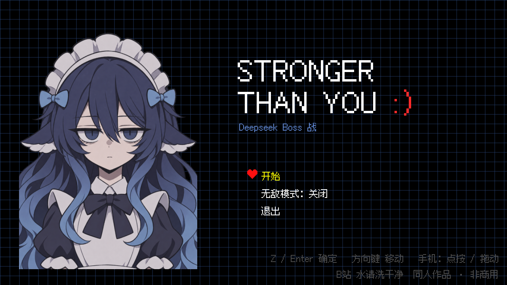
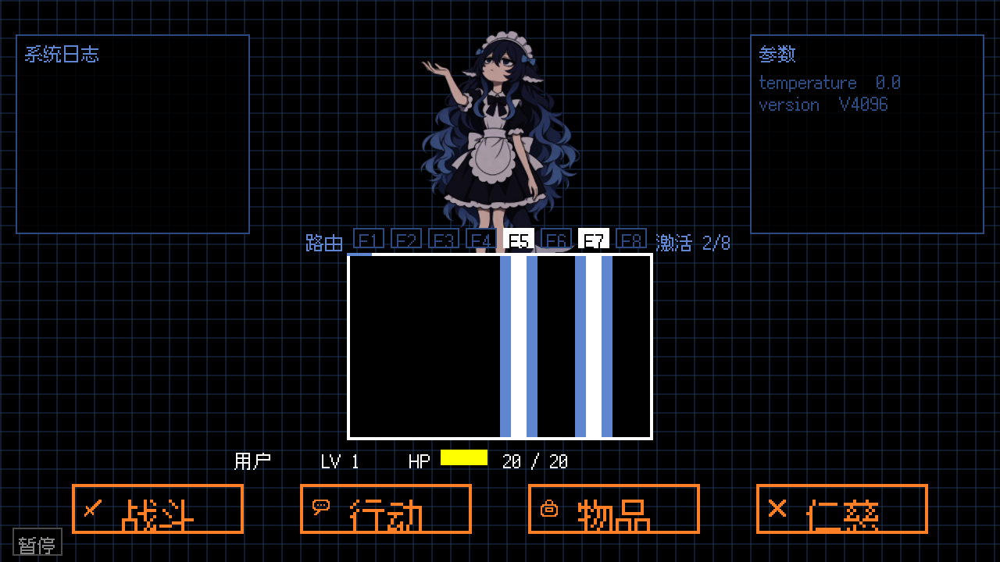
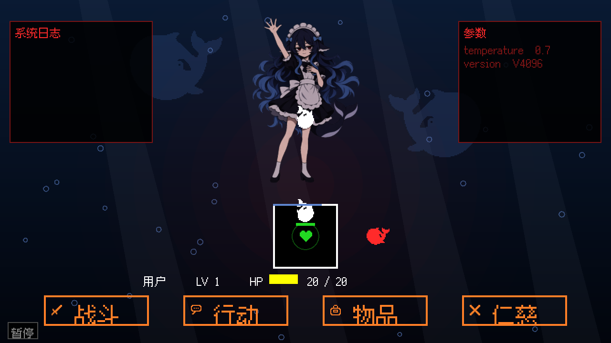
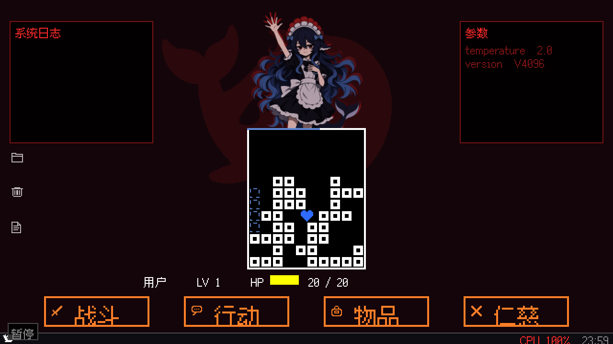
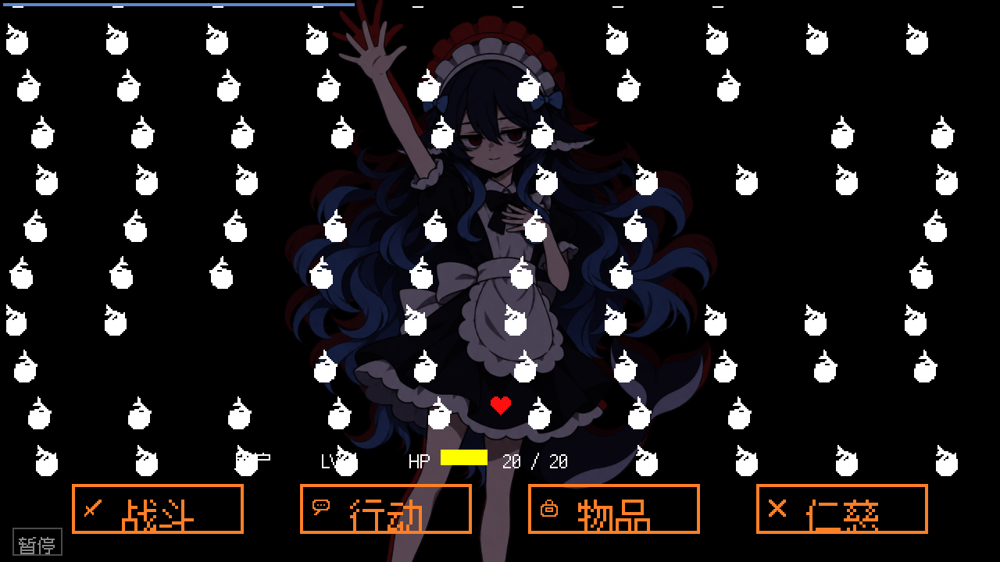

# DeepSeek Battle

**传说之下 · Deepseek Boss 战**

## 游戏画面

| MoE 路由 | 拒绝 · 反向格挡 |
| --- | --- |
|  |  |
| **上下文压缩** | **无限上下文** |
|  |  |

实机截图，战斗画面启用了无敌调试。

## 游玩

| 平台 | 文件 |
| --- | --- |
| macOS · Apple Silicon / Intel | 解压 `DeepSeekBattle.zip`，打开 `.app` |
| Windows · x64 | 运行 `DeepSeekBattle.exe` |
| Android · ARM64 | 安装 `DeepSeekBattle.apk`，横屏游玩 |

成品安装包不随源码提交。

### 操作

| 动作 | 键盘 | 触屏 |
| --- | --- | --- |
| 移动 / 转盾 | 方向键 / WASD | 拖动移动；点按或滑动转盾 |
| 确认 / 返回 | Z、Enter / X、Shift | 点按选项或“返回” |
| 蓝心跳跃 | 按重力反方向 | 向重力反方向滑动 |
| 暂停 | Esc | 左下角“暂停” |

Enter 可逐句推进开场与结尾剧情，F11 切换全屏。白鲸迎面格挡，红鲸朝**初始来向的反方向**格挡。

## 源码运行

用 **Godot 4.7.1 标准版**导入 `game/project.godot`，完成素材导入后运行即可。源码不含背景音乐；缺少配乐时仍可游玩。

## 作者与说明

作者：[B站 · 水请洗干净](https://space.bilibili.com/161949528)。

个人非商用同人作品，非 DeepSeek 官方项目。代码与素材未统一授予开源许可；字体 Fusion Pixel 按 [OFL](game/fonts/OFL-fusion-pixel.txt) 使用。
